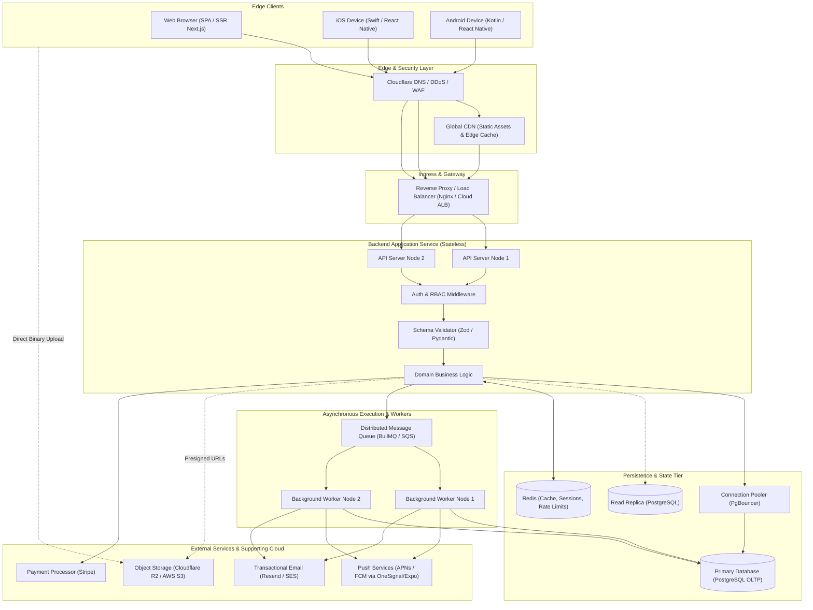
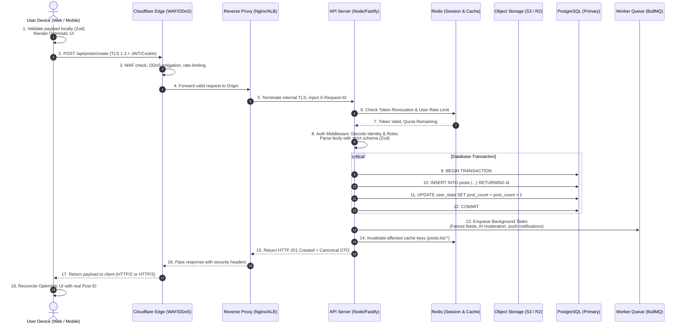
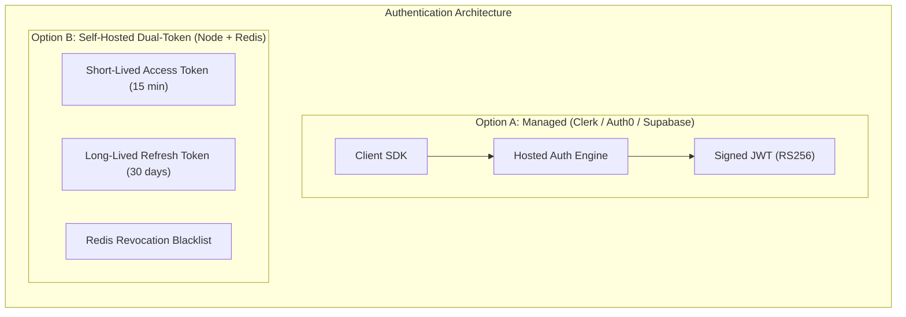
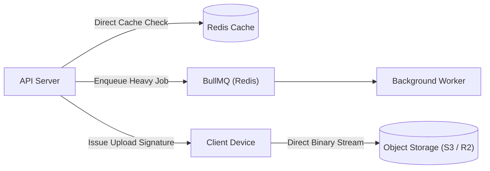
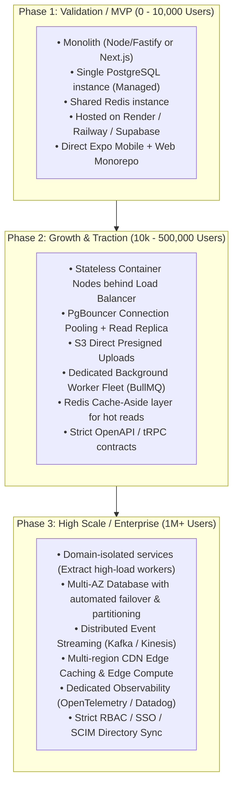

# End-to-End Modern Full Stack Architecture Guide
## Web, Mobile, Backend, Database, and Supporting Distributed Systems

> **Target Audience:** Intermediate Full Stack Engineers building production-grade web and mobile applications with AI assistance.  
> **Purpose:** Architectural mental model, trade-off analysis, decision frameworks, and verification checklists to rigorously audit, steer, and correct AI-generated code.

---

## Table of Contents
1. [High-Level System Topology](#1-high-level-system-topology)
2. [Client Convergence & Divergence (Web vs. Mobile)](#2-client-convergence--divergence-web-vs-mobile)
3. [Lifecycle of a Single User Request](#3-lifecycle-of-a-single-user-request)
4. [Layer-by-Layer Architectural Deep Dive & Tradeoffs](#4-layer-by-layer-architectural-deep-dive--tradeoffs)
   - [4.1 Frontend Layer (Web)](#41-frontend-layer-web)
   - [4.2 Mobile Client Layer](#42-mobile-client-layer)
   - [4.3 API Protocol & Contract Layer](#43-api-protocol--contract-layer)
   - [4.4 Backend Application Layer](#44-backend-application-layer)
   - [4.5 Authentication & Authorization Layer](#45-authentication--authorization-layer)
   - [4.6 Persistence Layer (Database)](#46-persistence-layer-database)
   - [4.7 Supporting Services (Cache, Queues, Storage, Push)](#47-supporting-services-cache-queues-storage-push)
   - [4.8 Hosting, Infrastructure & CI/CD](#48-hosting-infrastructure--cicd)
5. [Side-by-Side Technology Decision Matrices](#5-side-by-side-technology-decision-matrices)
6. [Steering & Auditing AI-Generated Codebases](#6-steering--auditing-ai-generated-codebases)
   - [6.1 Reversibility Matrix (Type 1 vs. Type 2 Decisions)](#61-reversibility-matrix-type-1-vs-type-2-decisions)
   - [6.2 AI Blindspots & Failure Modes](#62-ai-blindspots--failure-modes)
   - [6.3 Production Code Review Checklist](#63-production-code-review-checklist)
   - [6.4 Prompt Templates for Steering AI Code Generation](#64-prompt-templates-for-steering-ai-code-generation)
7. [Scale Adaptations: MVP to Enterprise](#7-scale-adaptations-mvp-to-enterprise)

---

## 1. High-Level System Topology

In a modern production application serving both browser and native mobile users, architecture is structured as a **unified backend core** serving **specialized edge clients**.



### Architectural Responsibilities by Layer
- **Edge Clients (Web & Mobile):** Render UI, capture interactions, perform optimistic client-side updates, manage local device caching, and securely persist authentication tokens.
- **Edge & Security Layer (CDN / WAF):** Terminates TLS, stops volumetric DDoS attacks, handles IP rate limiting, caches static bundles (`.js`, `.css`, `.png`), and inspects incoming payloads for malicious exploits (SQL injection, XSS).
- **Ingress Layer (Load Balancer / Reverse Proxy):** Directs traffic across stateless application instances, handles zero-downtime blue/green deployments, terminates internal TLS, and injects global telemetry correlation IDs (`X-Request-ID`).
- **Backend Core (Stateless Compute):** Executes domain business logic, enforces authentication and multi-tenant authorization boundaries, validates all input strictly, coordinates transactions, and dispatches long-running operations to background queues.
- **Persistence Tier (Relational DB & Cache):** Guarantees ACID transactional state, enforces foreign key relational integrity, manages operational read/write traffic, and provides sub-millisecond ephemeral key-value lookups.
- **Asynchronous Tier (Queues & Workers):** Decouples latency-intensive tasks (image resizing, video transcode, webhook dispatch, push notifications, billing reconciliation) from the synchronous HTTP request-response cycle.

---

## 2. Client Convergence & Divergence (Web vs. Mobile)

One of the most frequent mistakes made when designing or using AI to build a full stack product is treating mobile apps as "websites packed into an app shell," or maintaining two completely isolated backends for web and mobile.

### Where Web and Mobile Converge
1. **Unified API Contract:** Both web and mobile must consume the identical REST/tRPC/GraphQL backend endpoints. Never build separate `/api/web/...` and `/api/mobile/...` routes unless you are deliberately running a Backend-for-Frontend (BFF) gateway.
2. **Shared Domain Types and Validation:** In a TypeScript monorepo (e.g., Turborepo, Nx), validation schemas (Zod) and TypeScript interfaces for database models, API request payloads, and API responses should live in a shared package (`@repo/types` or `@repo/validators`) imported by the Web client, Mobile client, and Backend.
3. **Optimistic State & Client Cache Semantics:** Both platforms should utilize similar server-state management paradigms (e.g., TanStack Query / React Query), ensuring consistent stale-while-revalidate caching, mutation rollbacks, and background polling behavior.
4. **Business Invariants:** All authorization, state machine transitions, pricing calculations, and data validations must reside in the backend. Never rely on client-side code on either platform to enforce business rules.

### Where Web and Mobile Diverge

| Architectural Dimension | Web Client | Native / Cross-Platform Mobile Client |
| :--- | :--- | :--- |
| **Runtime Environment** | Web Browser Sandbox (V8, WebKit, SpiderMonkey) executing DOM and CSS. | Native OS (iOS Darwin / Android Linux) running native view hierarchies (UIKit/Jetpack Compose) or React Native (Yoga Flexbox engine). |
| **Token Storage Security** | **HTTP-Only, Secure, SameSite=Strict cookies.** Javascript *cannot* read these cookies, rendering the session immune to Cross-Site Scripting (XSS). | **OS Keychain (iOS) / Keystore (Android)** via `SecureStore` or `EncryptedSharedPreferences`. Mobile apps cannot use HTTP-only cookies securely across native background threads. |
| **Push Notifications** | Web Push API via Service Workers. Flaky support on iOS Safari (requires user adding PWA to Home Screen, permissions frequently revoked). | Hardware-level APNs (Apple) & FCM (Google). High reliability, background silent triggers, badge counts, sound control. |
| **Offline & Network Volatility** | Assumes reasonably steady connection. If network drops, standard browser retry patterns or error overlays suffice. | **Must be built offline-first.** Frequent cell tower switching, subway dead-zones. Requires local SQLite/WatermelonDB/MMKV mutation queues that replay on reconnect. |
| **Deployment Lifecycle** | **Instant.** Code deployed to CDN/Vercel/S3 is live for all users worldwide within seconds. Easy instant rollback. | **Delayed & Multi-versioned.** App Store and Google Play reviews take hours to days. Users may delay updates for months. **The backend must maintain backward compatibility across multiple legacy app versions.** |
| **Hardware Access** | Sandboxed APIs via browser permission prompts (Camera, Geolocation, Web Audio). | Full direct hardware abstraction (Bluetooth LE, Secure Enclave biometrics, accelerometer, background location, native audio codecs). |

---

## 3. Lifecycle of a Single User Request

To understand where bugs, race conditions, and performance bottlenecks occur, trace a single user interaction from the screen to the disk and back.

**Concrete Scenario:** An authenticated attendee taps "Publish Post with Image" in either the web or mobile app.



### Detailed Execution Breakdown

1. **Client Action & Optimistic Update:**
   - The user inputs text and attaches an image.
   - The client immediately runs client-side schema validation (ensuring image is `< 10MB`, text is `1-2000 chars`).
   - The client generates a temporary UUID (`temp-uuid-1234`), renders the new post in the feed immediately (optimistic UI), and locks the button to prevent duplicate submissions.
2. **Edge Ingress & WAF:**
   - The HTTPS request travels via DNS Anycast to the nearest Cloudflare point of presence.
   - WAF checks for SQLi signatures in the JSON payload, verifies that the IP is not blacklisted, and checks the edge rate-limit bucket (e.g., max 30 requests/min per IP).
3. **Load Balancer / Reverse Proxy:**
   - Nginx receives the request on port 443, terminates external TLS, extracts or generates an `X-Request-ID: req_8f93a1c`, and load balances the connection to one of the available Node.js/Go backend worker processes via an internal private subnet.
4. **Backend Ingress Middleware:**
   - **CORS Guard:** Verifies the `Origin` header matches allowed domains (applies to Web; native mobile sends no Origin header).
   - **Security Headers:** Sets `X-Content-Type-Options: nosniff`, `Strict-Transport-Security`, `X-Frame-Options: DENY`.
   - **Timeout Guard:** Attaches a hard cancellation timeout (e.g., 10 seconds) to prevent hanging connections.
5. **Authentication & Authorization Guard:**
   - For Web: Reads the signed, HTTP-only cookie.
   - For Mobile: Reads the `Authorization: Bearer <JWT>` header.
   - Validates cryptographic signature using asymmetric public key (RS256) or shared secret (HS256).
   - Queries Redis: has this user's session been remotely revoked or logged out?
   - Injects the authenticated `CurrentUserContext` into the request pipeline.
6. **Input Validation & Parsing:**
   - The controller executes runtime schema validation (e.g., `Zod.parse(req.body)`).
   - Strips unrecognised or malicious fields (preventing mass-assignment vulnerabilities).
   - If invalid, execution halts immediately with `HTTP 422 Unprocessable Entity` and structured field-level error messages.
7. **Business Logic & Transactional Boundary:**
   - The service layer acquires a database client from the connection pool (`PgBouncer`).
   - Executes an explicit SQL transaction: `BEGIN`.
   - Inserts the post row, decrements user upload quota, increments post counter.
   - Executes `COMMIT`. If any query fails, the pool automatically issues `ROLLBACK`, leaving zero orphan data.
8. **Asynchronous Decoupling (Queue Dispatch):**
   - The backend *does not* process notifications or image resizing inside the HTTP cycle.
   - A task payload (`{ event: "POST_CREATED", postId: "...", userId: "..." }`) is pushed to a Redis-backed queue (`BullMQ`).
   - The HTTP controller returns `HTTP 201 Created` with the sanitized Post Data Transfer Object (DTO).
9. **Client Reconciliation:**
   - The client receives the `HTTP 201 Created`.
   - TanStack Query swaps the temporary `temp-uuid-1234` with the real database UUID and timestamps.
   - If the request had failed with `500` or `422`, the optimistic post would be rolled back and an error banner rendered.

---

## 4. Layer-by-Layer Architectural Deep Dive & Tradeoffs

---

### 4.1 Frontend Layer (Web)

The web frontend's job is to download minimal JavaScript, render accessible and responsive markup, maintain local client state, and provide fluid interactions across desktop and mobile browsers.

```
       [ Client-Side Router / TanStack Query Cache ]
                            │
       [ Server Component (RSC) vs Client Component ]
                            │
               [ UI Component Hierarchy ]
          (Radix Primitives / Tailwind CSS)
```

#### Key Architectural Patterns
- **Server-Side Rendering (SSR) vs Single Page Application (SPA):**
  - **SPA (Vite + React):** HTML is an empty shell (`<div id="root"></div>`). Browser downloads JS bundle, then fetches data. Fast subsequent page transitions, trivial to host (S3/Cloudflare Pages), but poor initial SEO and slower First Contentful Paint (FCP) on slow networks.
  - **SSR / Hybrid (Next.js App Router):** HTML is pre-rendered on the server per request. Instant First Contentful Paint, perfect SEO, smaller initial JS bundle sent to client via React Server Components (RSC), but requires a running Node.js server or edge runtime, introducing server latency and edge cold starts.

#### Critical Pitfalls AI Assistants Produce
- **Overusing Client Components:** AI defaults to slapping `'use client'` at the top of every file in Next.js, completely negating the architectural benefits of React Server Components and bloating the client bundle.
- **Leaking Data via Props:** Passing an entire database user model (including password hashes or stripe customer IDs) into a client component prop where it gets serialized directly into the client HTML source.

---

### 4.2 Mobile Client Layer

The mobile client's job is to run smoothly at 60/120 FPS on resource-constrained hardware, manage battery consumption, handle offline state, and interact with native OS subsystems.

```
               [ Mobile UI Screens ]
                         │
     [ Local Persistent Cache: MMKV / SQLite ]
                         │
     [ OS Keychain / Android Keystore (Tokens) ]
                         │
         [ Background Push Notification Listener ]
```

#### Key Architectural Patterns
- **React Native (Expo Managed Workflow):**
  - Single TypeScript codebase compiles to real native iOS UIKit and Android views via the Hermes JavaScript engine.
  - Expo Application Services (EAS) abstracts native Xcode and Gradle build chains while allowing custom native modules via config plugins.
- **Token Security:** Native mobile apps must never store authentication tokens in unencrypted `AsyncStorage` (vulnerable on rooted/jailbroken devices or physical backup extraction). Use `expo-secure-store` which writes to the iOS Keychain and Android Keystore.
- **Handling Unreliable Connectivity:** Mobile applications must implement defensive network retry logic with exponential backoff and jitter.

#### Critical Pitfalls AI Assistants Produce
- **Memory Leaks in Background Listeners:** Attaching global event listeners or setInterval loops inside React Native components without returning cleanup unmount handlers.
- **Ignoring Safe Area and Keyboard Offsets:** AI builds beautiful forms that get permanently hidden underneath the iOS software keyboard or the iPhone Dynamic Island because it forgets `KeyboardAvoidingView` and `SafeAreaView`.

---

### 4.3 API Protocol & Contract Layer

The API layer is the formal boundary between client and server.

```
[ Web / Mobile Clients ] ── (Zod Schemas / OpenAPI Spec) ──> [ API Controller ]
```

#### The Three Dominant Approaches

1. **REST with OpenAPI (Swagger) & Zod (Recommended Standard):**
   - **Why:** Universal, highly debuggable in Network Inspector/cURL, supported natively by every language, easy to cache with HTTP proxies.
   - **How to make it type-safe:** Use code-first libraries like `ts-rest` or `trpc-openapi`, or generate OpenAPI schemas directly from Zod definitions (`@asteasolutions/zod-to-openapi`). Client SDKs can be generated automatically via `openapi-typescript-codegen`.

2. **tRPC (Best for Single Full-Stack TypeScript Teams):**
   - **Why:** Zero build-step type safety. Change a backend router function signature, and TypeScript immediately flags an error in your frontend or mobile codebase.
   - **Tradeoff:** Couples your client strictly to a TypeScript backend. If you ever rewrite a microservice in Go or Python, or expose public APIs to third parties, tRPC cannot serve them directly.

3. **GraphQL (Best for Massive Multi-Consumer Graph Data):**
   - **Why:** Prevents over-fetching; clients query precisely the fields they need.
   - **Tradeoffs:** High engineering overhead. Prevents simple HTTP caching at the CDN level. Highly susceptible to severe performance vulnerabilities (the N+1 query problem and malicious deeply nested queries) without complex query depth limiters and DataLoader patterns.

---

### 4.4 Backend Application Layer

The backend's job is to execute business logic, enforce authorization, coordinate database transactions, and serve responses with predictable latency.

```
[ Ingress Controller ] 
       │ (HTTP Request / Response)
[ Middleware Pipeline ] (Correlation ID, Rate Limiter, Auth Guard, Validation)
       │ (Validated DTO)
[ Domain Service Layer ] (Business rules, state machine, external calls)
       │ (Entity / Repository Pattern)
[ Data Access Layer ] (ORM / Query Builder via Connection Pool)
```

#### Architectural Requirements
- **Stateless Compute:** Backend instances must never store user state, uploaded files, or session memory in local process variables. Any server node must be able to crash or scale down without dropping active user sessions.
- **Clean Layered Separation:**
  1. *Controllers / Handlers:* Extract inputs, run Zod validation, call service, map result to HTTP status code.
  2. *Services:* Pure domain logic, authorization enforcement, transaction orchestration.
  3. *Repositories / Data Access:* Isolated SQL queries and ORM interactions.

#### Critical Pitfalls AI Assistants Produce
- **Fat Controllers with Leaky Abstractions:** AI routinely dumps raw database SQL queries or ORM calls directly inside the HTTP request handler, making unit testing impossible and mixing transport logic with business rules.
- **Unbounded Queries:** AI writes `prisma.post.findMany()` without mandatory `take` (limit) and `skip` (offset/cursor), which crashes the server once the table reaches 50,000 rows.

---

### 4.5 Authentication & Authorization Layer

Authentication answers **who you are**; Authorization answers **what you are allowed to do**.



#### Dual-Token Pattern (The Industry Standard for Custom Auth)
1. **Access Token:** Short-lived (15 minutes). Sent in every request header (`Authorization: Bearer <token>`) or cookie. Contains minimal claims (`userId`, `role`, `orgId`). Signed cryptographically. Validated statelessly by the backend without hitting the database.
2. **Refresh Token:** Long-lived (7 to 30 days). Stored in a database table or Redis. When the access token expires, the client calls `/api/auth/refresh`. The server checks the database: is this refresh token revoked? If valid, it issues a *new* access token and *rotates* the refresh token (Refresh Token Rotation).
3. **Token Revocation Strategy:** If a user clicks "Log out of all devices" or changes their password, store `user_token_version` in the database/Redis. When an access token arrives, if its version is older than the active version, reject it immediately.

#### Authorization: RBAC vs ABAC
- **Role-Based Access Control (RBAC):** Checks fixed roles (`admin`, `member`, `viewer`). Simple to model in the database with an enum or lookup table.
- **Attribute-Based Access Control (ABAC):** Checks context and ownership: *"Can User X update Post Y?"* requires verifying `post.authorId === user.id || user.role === 'admin'`. Must always be checked in the domain service layer, never solely in URL route middleware.

---

### 4.6 Persistence Layer (Database)

The database is the foundational bedrock of your application. While code can be refactored easily, database mistakes pollute your data permanently and are exceptionally costly to migrate.

```
[ Node API Process ] ──> [ PgBouncer (Pooler) ] ──> [ PostgreSQL Primary (Write) ]
                                                            │ (WAL Replication)
                                                            ▼
                                                    [ PostgreSQL Replica (Read) ]
```

#### Relational (PostgreSQL) vs Document (MongoDB)
- **PostgreSQL is the correct default for 95% of applications.** It provides ACID guarantees, strict foreign keys, atomic migrations, JSONB columns for flexible semi-structured data, and vector indexing (`pgvector`) for AI embeddings.
- **MongoDB** only wins when data is naturally un-relational, rapidly polymorphic, and requires distributed horizontal sharding from day one.

#### Connection Pooling is Mandatory
PostgreSQL forks a separate operating system process for every connected client. If your Node.js or serverless instances scale to 200 concurrent connections, PostgreSQL's memory exhaustion will bring down the database.
- **Solution:** Always run a connection pooler like **PgBouncer** or use cloud poolers (AWS RDS Proxy, Supabase Transaction Pooler, Prisma Accelerate).

#### Primary Key Strategy: UUIDv7 vs Auto-Incrementing Integer
- Never use serial auto-incrementing integers (`1, 2, 3...`) for public IDs; users can scrape your platform by incrementing IDs and deduce company transaction volume.
- Use **UUIDv7** (time-sortable UUIDs) or **NanoIDs**. Unlike random UUIDv4, UUIDv7 embeds a timestamp prefix, ensuring that B-Tree database indexes do not suffer fragmentation and performance degradation during high-throughput inserts.

---

### 4.7 Supporting Services (Cache, Queues, Storage, Push)

A production backend cannot survive on compute and database alone.



#### 1. In-Memory Caching (Redis)
- **Job:** Caches expensive SQL query results, maintains user rate-limit token buckets, holds active user websocket sessions, and acts as a distributed lock (`Redlock`).
- **Cache Invalidation Strategy:** Never cache indefinitely without a `TTL` (Time To Live). Use **Cache-Aside pattern**:
  1. Check Redis for key `post:123`.
  2. If hit, return immediately.
  3. If miss, query PostgreSQL, populate Redis with a 15-minute TTL, and return.
  4. On `UPDATE post`, explicitly delete the key `post:123`.

#### 2. Background Queues (BullMQ / Celery / SQS)
- **Job:** Moves slow, non-critical operations out of the user's synchronous HTTP cycle.
- **Golden Rule:** Background job execution **must be idempotent**. Because message brokers guarantee *at-least-once* delivery, a worker might process the same "Send Email" or "Charge Subscription" job twice. Use database unique constraints or idempotency keys in Redis to ensure a job executed multiple times produces the exact same outcome without duplicate actions.

#### 3. Object Storage & Presigned Direct Uploads (S3 / Cloudflare R2)
- **Job:** Stores user media, PDFs, and assets.
- **Direct-to-Cloud Upload Pattern (Crucial):** Never upload files through your Node.js backend (`Client -> Node API -> S3`). Doing so saturates your Node server's RAM and network I/O, freezing API requests for other users.
  - **The Right Way:**
    1. Client asks API: *"I want to upload a 5MB image `avatar.png`"*.
    2. API verifies permissions and asks S3 for a **Presigned PUT URL** valid for 5 minutes.
    3. API returns the URL to the client.
    4. Client uploads the binary payload directly to S3 via HTTP `PUT`.
    5. Client notifies API: *"Upload complete, here is the S3 key"*.

#### 4. Push Notifications (FCM / APNs)
- **Job:** Re-engages mobile attendees when the app is closed.
- **Architecture:** The client registers with Apple/Google on launch, receives an ephemeral `device_push_token`, and sends it to your database. When an event fires, a background worker batches these tokens and sends payloads to a provider like **Firebase Cloud Messaging (FCM)** or **OneSignal**, which negotiates deliverability directly with Apple and Google push servers.

---

### 4.8 Hosting, Infrastructure & CI/CD

```
[ Git Push to Main ] ──> [ GitHub Actions CI ] ──> [ Automated Test Suite & Linter ]
                                                         │ (On Success)
                                                         ▼
                                 [ Container Build & Migration Runner ]
                                                         │
                                 [ Zero-Downtime Deploy to Production ]
```

#### Infrastructure Stages
1. **Modern PaaS (Render, Railway, Fly.io):** The optimal balance for 90% of software products. Provides isolated container builds, automatic HTTPS certificate provisioning, managed PostgreSQL and Redis, and automated preview environments on pull requests without dedicated DevOps personnel.
2. **Serverless (Vercel, AWS Lambda, Cloudflare Workers):** Excellent for frontend rendering and lightweight APIs, but carries cold starts and complex connection pooling constraints with relational databases.
3. **Container Orchestration (Kubernetes / AWS ECS):** Only appropriate once engineering organizations exceed 20+ engineers or have strict compliance, multi-region routing, or specialized microservice requirements.

---

## 5. Side-by-Side Technology Decision Matrices

Use these matrices to evaluate technologies proposed by an AI assistant.

### Frontend Frameworks (Web)

| Technology | Learning Curve | Ecosystem | Performance | Scalability | Cost | Best Fit Scenario | AI-Assisted Suitability |
| :--- | :--- | :--- | :--- | :--- | :--- | :--- | :--- |
| **Next.js (App Router)** | Moderate to High | Massive | Excellent (SSR + Streaming) | High | Low to Moderate (Vercel/Node) | Content platforms, marketing sites, consumer web apps requiring high SEO. | **Mixed.** AI frequently confuses Pages Router and App Router conventions or misplaces `'use client'`. |
| **Vite + React (SPA)** | Low | Massive | Good (Fast after bundle load) | Very High (Edge CDN) | Lowest (Static S3/Cloudflare) | Internal tools, SaaS admin dashboards, authenticated apps behind logins. | **Strong.** Highly standardized; AI writes clean, idiomatic React SPA code with few hallucinations. |
| **SvelteKit** | Low | Small but Growing | Exceptional | High | Low | Small teams desiring minimal boilerplate and lightning-fast reactivity. | **Weak to Moderate.** Smaller training corpus; AI frequently hallucinates Svelte 4 syntax inside Svelte 5 runes. |

### Mobile Frameworks

| Technology | Learning Curve | Ecosystem | Performance | Scalability | Cost | Best Fit Scenario | AI-Assisted Suitability |
| :--- | :--- | :--- | :--- | :--- | :--- | :--- | :--- |
| **React Native (Expo)** | Low (if knowing React) | Massive | Very Good (Hermes Engine) | High | Low (Shared TS types with web) | Cross-platform mobile apps built alongside a React web frontend. | **Strong.** Expo APIs are standardized; AI handles UI layout and standard native features well. |
| **Flutter (Dart)** | Moderate | Large | Excellent (Skia/Impeller) | High | Moderate (Separate Dart language) | Highly animated, pixel-identical custom designs across iOS and Android. | **Moderate.** AI writes good Dart, but you lose monorepo TypeScript code-sharing with web/backend. |
| **Native (Swift / Kotlin)** | High | Segmented | Native Peak | Very High | High (Requires two distinct codebases) | Heavy hardware integrations, specialized background audio, complex 3D/AR. | **Moderate.** AI writes competent Swift/Kotlin, but maintaining feature parity across two repos triples review load. |

### Backend Frameworks

| Technology | Learning Curve | Ecosystem | Performance | Scalability | Cost | Best Fit Scenario | AI-Assisted Suitability |
| :--- | :--- | :--- | :--- | :--- | :--- | :--- | :--- |
| **Node.js (Fastify / Express + TS)** | Low | Largest in software | Good (Async I/O) | High (Horizontal scale) | Low | Standard REST/GraphQL APIs sharing types with web and mobile. | **Strong.** Extremely predictable output; AI excels at building standard middleware and route handlers. |
| **Go (Golang)** | Moderate | Large (Standard Lib) | Exceptional (Low RAM, fast concurrency) | Very High | Lowest (Tiny memory footprint) | High-throughput microservices, real-time networking, streaming services. | **Strong.** Go's strict simplicity and lack of syntactic magic make AI-generated Go code remarkably bug-free. |
| **Python (FastAPI)** | Low | Massive (Data/ML) | Moderate | Moderate to High | Moderate | Backends heavily reliant on AI/ML models, data processing, or scientific computing. | **Strong.** Pydantic integration ensures high type-safety; AI models understand Python intimately. |

### Database & ORM Options

| Technology | Learning Curve | Ecosystem | Performance | Scalability | Cost | Best Fit Scenario | AI-Assisted Suitability |
| :--- | :--- | :--- | :--- | :--- | :--- | :--- | :--- |
| **PostgreSQL + Drizzle ORM** | Moderate | Fast Growing | Exceptional (Lightweight SQL wrapper) | High | Low | Modern TypeScript backends wanting zero overhead and explicit SQL control. | **Moderate to Strong.** Clean SQL-like API; AI makes fewer schema migration mistakes than with Prisma. |
| **PostgreSQL + Prisma ORM** | Low | Massive | Moderate (Prisma engine overhead) | Moderate | Low | Fast prototyping and rapid schema iteration for standard CRUD apps. | **Strong in syntax, Weak in scaling.** AI writes Prisma effortlessly but frequently introduces catastrophic N+1 queries. |
| **Supabase (Managed Postgres)** | Very Low | Rapidly Growing | Excellent | High | Free tier to Moderate | Fast full-stack apps wanting built-in Auth, Storage, and Realtime with real Postgres. | **Strong.** AI tools understand Supabase JS SDK patterns well. |
| **MongoDB + Mongoose** | Low | Massive | Good for writes, Weak for relations | High | Low to High | Document-centric catalogues, unstructured JSON logs, zero relational joins. | **Moderate.** AI often defaults to NoSQL even when the user's data is inherently relational. |

---

## 6. Steering & Auditing AI-Generated Codebases

When working with an AI coding assistant, your role shifts from **author** to **system architect and code reviewer**. AI produces code quickly, but lacks global context, long-term operational foresight, and operational empathy.

### 6.1 Reversibility Matrix (Type 1 vs. Type 2 Decisions)

Jeff Bezos famously categorizes decisions into **Type 1 (irreversible, high-impact)** and **Type 2 (reversible, easy to change)**. When directing AI tools, you must guard Type 1 architectural decisions fiercely, while letting the AI freely handle Type 2 tasks.

```
┌──────────────────────────────────────────────────────────────────┐
│                   TYPE 1: HIGH-IMPACT (HARD TO REVERSE)          │
│  - Relational Database vs NoSQL                                  │
│  - Primary Key Strategy (UUIDv7 vs Auto-Increment)               │
│  - Multi-tenant Architecture (Shared DB vs Schema vs DB-per-tenant)│
│  - Auth Architecture (Cookie vs Token storage on Web)            │
│  - Monorepo vs Multi-repo structure                              │
│                                                                  │
│  * Action: Never let AI decide these implicitly. Specify upfront.* │
└───────────────────────────────────┬──────────────────────────────┘
                                    │
┌───────────────────────────────────▼──────────────────────────────┐
│                   TYPE 2: EASILY REVERSIBLE (LOW-IMPACT)         │
│  - UI component styling (Tailwind vs Vanilla CSS)                │
│  - ORM query syntax (refactoring Drizzle query to raw SQL)       │
│  - Icon libraries, form UI helpers, client formatting utils      │
│  - Specific hosting provider (Render vs Railway vs Fly.io)       │
│                                                                  │
│  * Action: Let AI choose defaults; refactor later if needed.*    │
└──────────────────────────────────────────────────────────────────┘
```

---

### 6.2 AI Blindspots & Failure Modes

When reviewing pull requests or generated code from an AI assistant, look specifically for these recurring vulnerabilities:

1. **The Phantom Security Middleware Trap:**
   - *What AI does:* Writes route protection in a middleware file that only checks if a token exists, but fails to verify the token signature or check whether the user has been banned/revoked.
   - *Fix:* Ensure token cryptographic verification happens on every non-public route, and ownership of the resource is cross-checked in the database.

2. **The Missing Database Transaction (`BEGIN...COMMIT`):**
   - *What AI does:* Executes multiple database writes sequentially across lines of code:
     ```typescript
     // AI CODE MISTAKE: If step 2 fails, step 1 is permanently committed!
     await db.insert(orders).values(orderData);
     await db.update(inventory).set({ count: stock - 1 }); 
     ```
   - *Fix:* Force the AI to wrap all interdependent database operations in a transaction (`db.transaction(async (tx) => { ... })`).

3. **The Unsafe File Upload Loopback:**
   - *What AI does:* Accepts a `multipart/form-data` upload on the Node server, reads the entire file into a RAM buffer (`multer.memoryStorage()`), and then slowly uploads it to AWS S3. Under 10 concurrent uploads, the server crashes with `Out Of Memory`.
   - *Fix:* Force AI to implement S3 Presigned URLs for direct-from-client uploads.

4. **The Silent Error Swallower:**
   - *What AI does:* To make code compile and run without visible crashes, AI writes:
     ```typescript
     try {
       await processPayment();
     } catch (err) {
       console.log("Error occurred", err); // Silently fails, returns HTTP 200!
     }
     ```
   - *Fix:* Reject any code where errors are caught without re-throwing, logging to an observability tool (Sentry), or returning a structured, non-200 HTTP error code.

5. **The Leaky DTO (Data Transfer Object):**
   - *What AI does:* Returns database rows directly to the frontend:
     ```typescript
     const user = await db.query.users.findFirst({ where: eq(users.id, id) });
     return res.json(user); // Leaks password_hash, stripe_id, internal audit flags!
     ```
   - *Fix:* Insist on explicit serialization layers or query `columns` whitelisting.

---

### 6.3 Production Code Review Checklist

Run through this checklist on any codebase built with AI assistance before shipping to production:

```markdown
### 1. Authentication & Security
- [ ] Are Web authentication tokens stored in HTTP-Only, Secure, SameSite cookies?
- [ ] Are Mobile authentication tokens stored in OS Keychain / Keystore?
- [ ] Is there an active refresh token rotation mechanism or revocation check?
- [ ] Are CORS headers restricted strictly to your known frontend domains (not `*`)?
- [ ] Does every protected endpoint check both Authentication (identity) and Authorization (resource ownership)?

### 2. API & Contract Consistency
- [ ] Do Web and Mobile consume the exact same backend endpoints?
- [ ] Is every input payload validated using a runtime schema (Zod/Pydantic) before reaching domain logic?
- [ ] Are API error responses structured with a uniform schema across all endpoints (e.g., `{ error: { code, message, details } }`)?
- [ ] Are mobile API routes versioned (`/api/v1/...`) to prevent breaking legacy native apps?

### 3. Database & Persistence
- [ ] Are all foreign keys indexed to prevent catastrophic full-table scans during joins?
- [ ] Are unique constraints enforced at the database schema level, not just in application code?
- [ ] Are database connection pools (PgBouncer) configured with explicit maximum connection ceilings?
- [ ] Are database migrations committed as tracked `.sql` files in version control, tested on empty and populated databases?
- [ ] Are all list queries strictly paginated using cursor-based or limit/offset parameters?

### 4. Asynchronous Queues & Background Processing
- [ ] Are heavy computational tasks (email, image processing, push notifications) handled asynchronously via workers?
- [ ] Are background jobs fully idempotent (safe to retry multiple times without duplicate side effects)?
- [ ] Do queues have Dead Letter Queues (DLQ) configured so failing poison-pill jobs do not block workers indefinitely?

### 5. Secrets Management & Operational Resilience
- [ ] Are zero API keys, secrets, or database URLs hardcoded in source control?
- [ ] Is there an `.env.example` file documenting every required environment variable?
- [ ] Is an Application Performance Monitoring (APM) and Error Tracking tool (e.g., Sentry) initialized on both client and server?
- [ ] Are all external third-party network calls wrapped in strict client timeouts (e.g., abort after 5000ms)?
```

---

### 6.4 Prompt Templates for Steering AI Code Generation

When prompting AI assistants (Claude, ChatGPT, Cursor, Copilot), use these structured templates to ensure high-grade architectural output.

#### Template 1: Generating a Type-Safe Database Migration & Entity
```text
Role: Senior Staff Database Engineer.
Task: Create the database schema and migration for [EntityName].
Requirements:
1. Use PostgreSQL syntax with [Drizzle ORM / Prisma].
2. Use UUIDv7 for the primary key.
3. Explicitly declare foreign key constraints with ON DELETE CASCADE/SET NULL where appropriate.
4. Add indexes on all foreign keys and high-cardinality query fields.
5. Include timestamps (created_at, updated_at) with UTC timezone defaults.
6. Provide the DTO type definition and the Zod input validation schema for creating and updating this entity, stripping any auto-generated fields.
Constraint: Do not generate soft-delete flags unless specifically requested; prefer explicit relational state machines.
```

#### Template 2: Generating a Robust API Endpoint
```text
Role: Principal Backend Architect.
Task: Implement the API route [POST /api/v1/resource].
Requirements:
1. Input validation using Zod schema. If invalid, return HTTP 422 with structured field errors.
2. Authentication check: Read identity from verified request context.
3. Authorization check: Verify that the requesting user owns the parent entity or holds an 'admin' role.
4. Business logic: Execute the operation inside a single database transaction.
5. If side effects exist (notifications, emails, image resizing), do not execute them inline; enqueue an idempotent job using [BullMQ / SQS].
6. Return HTTP 201 with a sanitized response DTO that excludes sensitive internal columns.
7. Wrap in try/catch and delegate unexpected errors to the global error-handling middleware. Do not swallow errors.
```

#### Template 3: Auditing an Existing Module
```text
Role: Lead Cybersecurity and Performance Auditor.
Task: Review the attached file for security vulnerabilities, race conditions, and performance bottlenecks.
Inspect strictly for:
1. Missing transactional boundaries (atomicity violations).
2. Unbounded database queries (missing limits/pagination).
3. Insecure token or secret handling.
4. Potential N+1 query loops.
5. Silent error suppression or missing timeout handling on external calls.
Provide your findings ranked by severity (Critical, High, Medium), accompanied by the exact before/after code diff to remediate each issue.
```

---

## 7. Scale Adaptations: MVP to Enterprise

The architectural blueprint changes based on transaction volume and team scale. Do not prematurely optimize for Google-scale when validating product-market fit.



### Architectural Shifts Across Milestones

| Component | MVP Stage (0 - 10k Users) | Growth Stage (10k - 500k Users) | Scale Stage (1M+ Users) |
| :--- | :--- | :--- | :--- |
| **Compute Architecture** | Single Monolithic Service or PaaS Serverless. | Horizontally scaled stateless containers (2 to 10 instances). | Clustered services with auto-scaling groups on AWS ECS/EKS. |
| **Database** | Single primary Postgres instance (2 vCPU, 4GB RAM). | Primary Postgres + 1 Read Replica + PgBouncer Pooler. | Multi-AZ Primary + Distributed Read Replicas + Table Partitioning. |
| **Caching** | Redis instance (shared between cache and small queue). | Dedicated Redis cluster with eviction policies (LRU). | Multi-tier caching: Edge CDN + In-memory local L1 cache + Redis L2. |
| **Asynchronous Jobs** | Simple in-process queue or Redis BullMQ. | Dedicated worker container fleet processing BullMQ/SQS. | High-throughput distributed event log (Apache Kafka / AWS SQS). |
| **File Storage** | Direct S3 / Cloudflare R2 bucket. | Presigned direct client uploads + Cloudflare CDN caching. | Multi-region storage with automated lifecycle transitions & async transcoding. |
| **Team / Codebase** | Unified TypeScript monorepo (Turborepo). | Monorepo with dedicated package isolation and strict linting. | Domain-driven services with independent CI/CD deployment pipelines. |

---

## Final Senior Mentor Summary Rulebook

1. **Keep the Database Relational by Default:** Unless you have non-relational, high-velocity time-series or document data, choose PostgreSQL.
2. **Never Trust the Client:** Validate everything at the server boundary with runtime schemas (Zod). Both web browsers and native mobile clients can be decompiled, tampered with, or bypassed via cURL.
3. **Decouple Fast Writes from Slow Tasks:** If an operation takes longer than 50 milliseconds (resizing images, dispatching emails, notifying followers), hand it to a background worker queue.
4. **Treat AI as a Fast Junior Developer:** AI will write code that *appears* to work on the surface, but will cut corners on edge cases, transactions, error handling, and scalability. Review its work against this architecture guide before merging.
