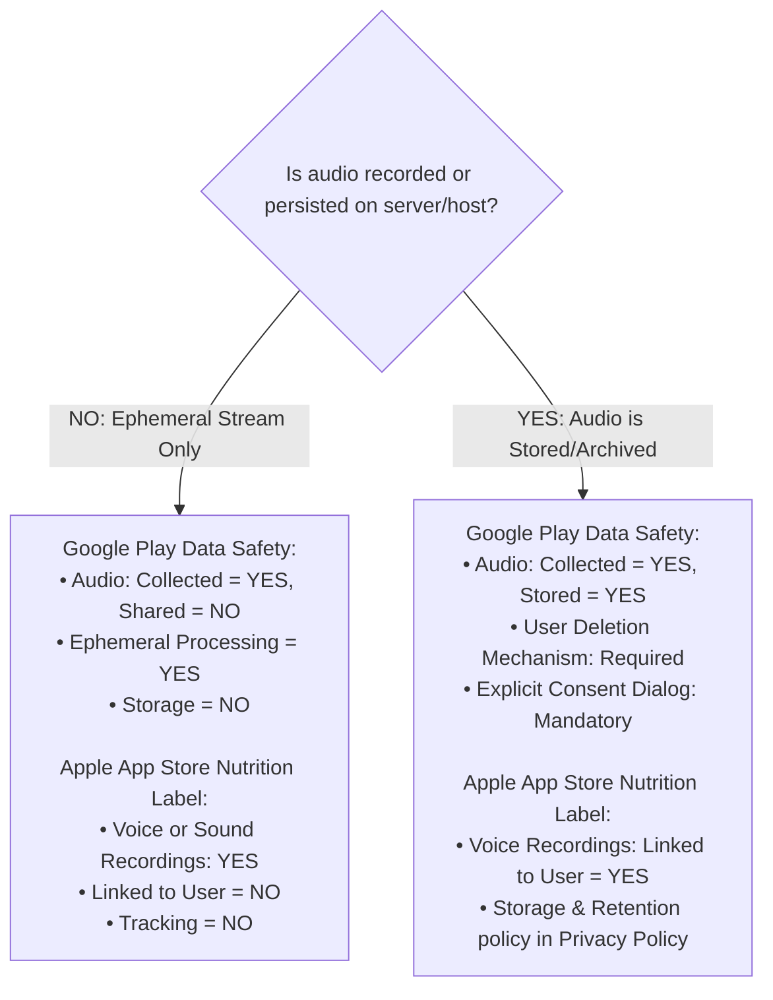

# End-to-End Mobile Launch Readiness Audit & Store Compliance Review
## Centralized Mic (React Native / iOS & Android)

**Document Version:** 1.0.0  
**Target Release Platforms:** Google Play Store & Apple App Store  
**Auditor:** Senior Mobile Release Engineer  
**Date:** October 2026  
**Status:** **NOT READY FOR PRODUCTION (LAUNCH BLOCKED)**

---

## 1. Executive Summary

A comprehensive, end-to-end technical, security, and store compliance audit was conducted on the React Native mobile codebase located in `/mobile`, its native Android/iOS harnesses, and its interfacing token service (`/server`).

### Overall Launch Readiness Verdict: **BLOCKED**

While the core WebRTC audio capture pipeline and low-latency floor arbitration logic are well-architected for interactive performance, **the mobile application is currently not shippable to either the Google Play Store or the Apple App Store**. Multiple structural and compliance blockers will trigger immediate automated or manual rejections during store ingest.

### Top Launch Blockers

| # | Blocker Category | Severity | Platform | Core Issue & Store Impact |
| :- | :--- | :--- | :--- | :--- |
| **1** | **Signing & Cryptography** | **CRITICAL** | Android | `android/app/build.gradle` signs the `release` build variant with `debug.keystore` using the default alias `androiddebugkey` and password `android`. **Google Play Console strictly rejects debug-signed binaries.** |
| **2** | **Native Project Container** | **CRITICAL** | iOS | The `mobile/ios/` directory contains only isolated source files (`AudioSessionConfigModule.h/.m`, `Info.plist`). **There is no `.xcodeproj`, `.xcworkspace`, `Podfile`, or `AppDelegate.mm`.** It is physically impossible to generate an iOS `.ipa` archive without scaffolding the native iOS container. |
| **3** | **Apple Privacy Manifest** | **CRITICAL** | iOS | **Missing `PrivacyInfo.xcprivacy`.** Since May 1, 2024, Apple rejects all app submissions that lack a root privacy manifest declaring Required Reason API usage (e.g., UserDefaults, file timestamps) and tracking domains. |
| **4** | **Background Execution Policy** | **HIGH** | iOS | `mobile/ios/Info.plist` declares `voip` under `UIBackgroundModes`. Apple App Store Review Guideline 2.5.4 mandates CallKit integration for the `voip` background mode; raw VoIP socket execution is deprecated and results in **immediate manual review rejection**. |
| **5** | **Permission Discrepancy** | **HIGH** | Android & iOS | Both platforms declare `CAMERA` permissions (`android.permission.CAMERA` and `NSCameraUsageDescription`), yet the React Native code implements **no in-app camera scanning**. (Android uses an out-of-process Play Services dialog; iOS has no scanner). Declaring unexercised sensitive permissions violates Google Play and Apple App Store policy. |
| **6** | **Foreground Service Policy** | **HIGH** | Android | `FOREGROUND_SERVICE_MICROPHONE` requires an explicit Play Console policy declaration, specific user-facing UI disclosure, and a video demonstration of runtime behavior under Google Play's 2024/2025 Android 14+ enforcement rules. |

---

## 2. Open Questions & Data Governance Assessment

The project team has not yet finalized determinations regarding user data collection or authentication. Below is an exhaustive audit of the codebase, configuration files, and dependencies to distinguish **confirmed facts** from **unconfirmed design choices**, accompanied by conditional compliance guidance.

### 2.1 Data Collection Audit

#### What is Confirmed Present in the Code:
1. **User Identity Strings**: `userName` (defaults to `"Maya Lin (Lead Vocals)"`) and a generated `participantId` (e.g., `phone-mayalin-8921`) are transmitted in plaintext JSON to the token broker endpoint (`POST /api/token/participant`) and broadcast across the WebRTC DataChannel (`topic: 'floor-control'`) to the host receiver and all room peers.
2. **Audio Stream**: Raw 48kHz mono audio captured via `RECORD_AUDIO` / `AVAudioSession` is encoded via Opus and transmitted over WebRTC SRTP/UDP directly to the LiveKit Cloud SFU.
3. **Network Identifiers**: The client communicates with `centralized-mic-token-server.onrender.com` (HTTPS) and `centralized-mic-v3q5zrd6.livekit.cloud` (WSS/WebRTC). Client IP addresses are naturally logged by the reverse proxy and the SFU.
4. **Device Audio State**: Sample rates, I/O buffer durations, and audio routing modes are queried via native modules (`AudioConfigModule` and `AudioSessionConfigModule`).

#### What is Confirmed Absent in Dependencies & Code:
1. **No Analytics SDKs**: No Google Analytics, Firebase Analytics, Mixpanel, Amplitude, or Segment libraries exist in `mobile/package.json`.
2. **No Advertising SDKs**: No Google Mobile Ads (AdMob), AppLovin, or Facebook Audience Network SDKs.
3. **No Crash Reporting SDKs**: No Sentry, Crashlytics, or Bugsnag integration.
4. **No Persistent Local Tracking**: No `@react-native-async-storage/async-storage`, SQLite, or MMKV dependencies exist. Data is held purely in volatile React component memory.
5. **No Location, Contacts, or Photos Access**: No permissions requested or native modules linked for GPS, Address Book, or Photo Library.

#### What Remains Unconfirmed:
- Does the backend server or LiveKit Cloud archive, record, or transcribe the audio streams to object storage (e.g., AWS S3, Cloudflare R2)?
- Does the host operator console persist attendee names and room logs into an external database?

#### Conditional Data Safety Guidance Matrix:



- **If Purely Ephemeral (Recommended)**:
  - **Google Play Data Safety Form**: Declare "Voice or sound recordings" as **Collected**, but mark **"This data is processed ephemerally: Yes"** and **"Is this data stored?: No"**. Declare purpose as **"App functionality"**.
  - **Apple Privacy Disclosures**: Select **"Voice or Sound Recordings"** under Audio Data, mark **"Used for App Functionality"**, mark **"Not linked to the user's identity"**, and mark **"Not used for tracking purposes"**.
- **If Audio is Recorded or Stored**:
  - Both stores mandate a comprehensive Privacy Policy specifying retention duration, cloud storage location, encryption-at-rest protocols, and a clear mechanism for attendees to request data deletion.

---

### 2.2 Authentication & Session Handling Audit

#### What is Confirmed in the Code:
1. **No User Accounts**: There is no user registration, login screen, password field, biometric authentication (TouchID/FaceID), or email collection.
2. **Room-Based Access Gate**: Access is controlled exclusively via a room code string (e.g., `STG-709`). Anyone possessing the room code can connect.
3. **Cryptographic Token Authorization**: The app exchanges the room code and arbitrary user handle for an ephemeral LiveKit JWT (`/api/token/participant`). The JWT expires in 3,600 seconds (1 hour).

#### What Remains Unconfirmed:
- Will the team introduce corporate single sign-on (SSO), OAuth, or user accounts prior to launch?

#### Conditional Authentication Guidance Matrix:

- **Scenario A: The App Launches Without User Accounts (Current Architecture)**
  - **Apple Review Guideline 4.8 (Sign in with Apple)**: **Does NOT apply**. Because there is no third-party or social login, Sign in with Apple is not required.
  - **Apple Review Guideline 5.1.1(v) (Account Deletion)**: **Does NOT apply**. Because users cannot create an account, an in-app account deletion workflow is not required.
  - **Reviewer Credentials**: You **must** provide the Apple and Google review teams with a persistent, active test room code (and ensure the host receiver is running or simulated during review), otherwise the app will be rejected under **Guideline 2.1 (App Completeness)** for failing to connect.
- **Scenario B: The App Adds Authentication Prior to Launch**
  - **If Third-Party Logins (Google, Facebook, Microsoft) are added**: You **must** offer **Sign in with Apple** as an equivalent primary option on iOS.
  - **If Any Account Creation is supported**: You **must** provide an in-app **"Delete Account"** option that immediately revokes tokens and purges stored user data.

---

## 3. Security Findings & Vulnerability Analysis

Findings are ordered by descending severity (**Critical $\to$ High $\to$ Medium $\to$ Low**).

```
[CRITICAL] SEC-01: Release Build Signed with Android Debug Keystore
[HIGH]     SEC-02: Extraneous Camera Permissions in Native Manifests
[HIGH]     SEC-03: Proguard / R8 Bytecode Obfuscation Disabled in Release
[HIGH]     SEC-04: Unjustified VoIP Background Execution Mode in iOS Info.plist
[MEDIUM]   SEC-05: Verbose Console Logging Active in Production Runtime
[MEDIUM]   SEC-06: Lack of Public Key Pinning on Token Broker & SFU Endpoints
[LOW]      SEC-07: Hardcoded Default Identity Leaking into Public Audio Channel
```

---

### [CRITICAL] SEC-01: Release Build Signed with Android Debug Keystore
- **File:** [`mobile/android/app/build.gradle`](file:///home/nabeel/Downloads/CENTRALIZED_MIC/mobile/android/app/build.gradle#L34-L38)
- **Why it Matters:** The `release` build type explicitly reuses `signingConfigs.debug`:
  ```groovy
  buildTypes {
      release {
          signingConfig signingConfigs.debug
          ...
      }
  }
  ```
  The debug keystore uses public, well-known credentials (`storePassword 'android'`, `keyAlias 'androiddebugkey'`). Deploying an app signed with a debug key violates fundamental Android security: attackers can recompile, inject malware, sign with the same public key, and execute arbitrary updates on user devices. Furthermore, **Google Play Console will hard-reject any AAB uploaded with a debug signature**.
- **Concrete Fix:**
  1. Generate a production release keystore:
     ```bash
     keytool -genkey -v -keystore release.keystore -alias centralized-mic-key -keyalg RSA -keysize 2048 -validity 10000
     ```
  2. Store the keystore file outside source control (or inject via CI/CD secrets).
  3. Configure environment variable binding in `mobile/android/app/build.gradle`:
     ```groovy
     signingConfigs {
         release {
             if (System.getenv("STORE_FILE")) {
                 storeFile file(System.getenv("STORE_FILE"))
                 storePassword System.getenv("STORE_PASSWORD")
                 keyAlias System.getenv("KEY_ALIAS")
                 keyPassword System.getenv("KEY_PASSWORD")
             }
         }
     }
     buildTypes {
         release {
             signingConfig signingConfigs.release
             ...
         }
     }
     ```

---

### [HIGH] SEC-02: Extraneous Camera Permissions in Native Manifests
- **Files:**
  - [`mobile/android/app/src/main/AndroidManifest.xml`](file:///home/nabeel/Downloads/CENTRALIZED_MIC/mobile/android/app/src/main/AndroidManifest.xml#L14-L16)
  - [`mobile/ios/Info.plist`](file:///home/nabeel/Downloads/CENTRALIZED_MIC/mobile/ios/Info.plist#L32-L34)
- **Why it Matters:**
  - In `AndroidManifest.xml`, lines 14–16 declare `<uses-permission android:name="android.permission.CAMERA" />`. However, in [`AudioConfigModule.java`](file:///home/nabeel/Downloads/CENTRALIZED_MIC/mobile/android/app/src/main/java/com/wirelessmic/AudioConfigModule.java#L101-L130), QR scanning is implemented using `com.google.mlkit.vision.codescanner.GmsBarcodeScanning`. The Google Play Services Code Scanner operates out-of-process and **does not require the application to hold camera permission**.
  - In `Info.plist`, lines 32–34 declare `NSCameraUsageDescription`, but the iOS native module [`AudioSessionConfigModule.m`](file:///home/nabeel/Downloads/CENTRALIZED_MIC/mobile/ios/AudioSessionConfigModule.m) has **no QR scanning code whatsoever**, and `NativeAudio.scanQRCode()` returns `null` on iOS.
  - **Store Impact**: Requesting camera access without exercising it triggers **Google Play Permissions Policy rejection** and **Apple App Store Review Guideline 5.1.1 rejection**.
- **Concrete Fix:**
  - Remove camera lines from `mobile/android/app/src/main/AndroidManifest.xml`:
    ```xml
    <!-- REMOVE THESE THREE LINES -->
    <uses-permission android:name="android.permission.CAMERA" />
    <uses-feature android:name="android.hardware.camera" android:required="false" />
    <uses-feature android:name="android.hardware.camera.autofocus" android:required="false" />
    ```
  - For iOS, either implement a native AVFoundation QR scanner in `AudioSessionConfigModule.m` or remove `NSCameraUsageDescription` from `Info.plist`.

---

### [HIGH] SEC-03: Proguard / R8 Bytecode Obfuscation Disabled in Release
- **File:** [`mobile/android/app/build.gradle`](file:///home/nabeel/Downloads/CENTRALIZED_MIC/mobile/android/app/build.gradle#L5)
- **Why it Matters:** `def enableProguardInReleaseBuilds = false`. Without R8/Proguard:
  1. The production binary contains fully decompilable Java/Kotlin bytecode, exposing proprietary audio routing logic and internal API routes.
  2. Unused WebRTC and MLKit native libraries are not dead-code stripped, bloating the binary download size by 15–25 MB.
- **Concrete Fix:**
  1. Set `def enableProguardInReleaseBuilds = true` in `mobile/android/app/build.gradle`.
  2. Add keep rules for LiveKit, React Native, and MLKit in `mobile/android/app/proguard-rules.pro`:
     ```proguard
     -keep class com.wirelessmic.** { *; }
     -keep class com.livekit.** { *; }
     -keep class org.webrtc.** { *; }
     -dontwarn org.webrtc.**
     -keep class com.google.mlkit.** { *; }
     ```

---

### [HIGH] SEC-04: Unjustified VoIP Background Execution Mode in iOS Info.plist
- **File:** [`mobile/ios/Info.plist`](file:///home/nabeel/Downloads/CENTRALIZED_MIC/mobile/ios/Info.plist#L37-L41)
- **Why it Matters:** The plist specifies:
  ```xml
  <key>UIBackgroundModes</key>
  <array>
      <string>audio</string>
      <string>voip</string>
  </array>
  ```
  Apple App Store Review Guideline 2.5.4 strictly limits `voip` background mode to applications integrating Apple's **CallKit** framework and utilizing **PushKit** VoIP push notifications. Legacy raw VoIP sockets were terminated in iOS 13. Because this app does not implement CallKit incoming calls, declaring `voip` will trigger **immediate Apple App Review rejection**.
- **Concrete Fix:** Remove `<string>voip</string>` from `Info.plist`. Retain only `<string>audio</string>`, which is fully compliant for live microphone capture and transmission:
  ```xml
  <key>UIBackgroundModes</key>
  <array>
      <string>audio</string>
  </array>
  ```

---

### [MEDIUM] SEC-05: Verbose Console Logging Active in Production Runtime
- **Files:**
  - [`mobile/src/hooks/useLiveKitTransmitter.ts`](file:///home/nabeel/Downloads/CENTRALIZED_MIC/mobile/src/hooks/useLiveKitTransmitter.ts#L149-L306)
  - [`mobile/src/native/NativeAudioConfig.ts`](file:///home/nabeel/Downloads/CENTRALIZED_MIC/mobile/src/native/NativeAudioConfig.ts#L24-L91)
  - [`mobile/App.tsx`](file:///home/nabeel/Downloads/CENTRALIZED_MIC/mobile/App.tsx#L105)
- **Why it Matters:**
  - In React Native, `console.log` statements are synchronous across the JavaScript-to-C++ bridge on older architectures and emit directly to Android Logcat and Apple unified logging system (`syslog`).
  - Active logs print room tokens, participant identifiers, room codes, and internal error structures, accessible by any process with log-reading permissions on rooted/jailbroken devices.
  - In `mobile/App.tsx` line 105, user-facing error text says: `"Room STG-709 is closed or rejected handshake. Check console."` Users on production devices have no developer console.
- **Concrete Fix:**
  1. Install `babel-plugin-transform-remove-console`:
     ```bash
     npm --prefix mobile install --save-dev babel-plugin-transform-remove-console
     ```
  2. Configure `mobile/babel.config.js`:
     ```javascript
     module.exports = {
       presets: ['module:@react-native/babel-preset'],
       plugins: [
         ...(process.env.NODE_ENV === 'production' ? ['transform-remove-console'] : []),
       ],
     };
     ```
  3. Replace `"Check console"` in `App.tsx` with `"Please check room code or verify host is online."`

---

### [MEDIUM] SEC-06: Lack of Public Key Pinning on Token Broker & SFU Endpoints
- **Files:**
  - [`mobile/App.tsx`](file:///home/nabeel/Downloads/CENTRALIZED_MIC/mobile/App.tsx#L27)
  - [`mobile/src/hooks/useLiveKitTransmitter.ts`](file:///home/nabeel/Downloads/CENTRALIZED_MIC/mobile/src/hooks/useLiveKitTransmitter.ts#L49)
- **Why it Matters:**
  - The client connects to `TOKEN_SERVER_URL = 'https://centralized-mic-token-server.onrender.com'`.
  - While HTTPS prevents passive eavesdropping, users on untrusted public Wi-Fi networks (hotels, airports, convention centers) with rogue or compromised root CA certificates could be vulnerable to Man-in-the-Middle (MitM) attacks intercepting attendee tokens.
- **Concrete Fix:**
  - For standard enterprise environments, maintain standard TLS 1.3 verification with strict hostname checking.
  - For high-security corporate installations, implement network security config pinning (`network_security_config.xml` on Android) or certificate public key pinning via native networking libraries.

---

### [LOW] SEC-07: Hardcoded Default Identity Leaking into Public Audio Channel
- **File:** [`mobile/App.tsx`](file:///home/nabeel/Downloads/CENTRALIZED_MIC/mobile/App.tsx#L36)
- **Why it Matters:**
  - `const [userName, setUserName] = useState('Maya Lin (Lead Vocals)');`
  - If a user quickly taps "Connect" without typing their name, every attendee appears on the host board and WebRTC peers with the identical handle `"Maya Lin (Lead Vocals)"`.
- **Concrete Fix:**
  - Initialize `userName` as empty: `const [userName, setUserName] = useState('');`
  - In `handleNameChange`, fallback to `"Attendee " + participantId.slice(-4)` if left blank.

---

## 4. Google Play Store Requirements Checklist

| Requirement Area | Specification & Current Policy Status | Project Audit Status | Action Required |
| :--- | :--- | :--- | :--- |
| **Target API Level** | Must target **API 34 (Android 14)** or higher (API 35 required for updates starting Aug 2025). | **PASS** (`targetSdkVersion = 34` in `build.gradle`). | Verify compatibility with Android 15 (API 35) in Q2 2025. |
| **App Bundle Format** | Google Play mandates the **Android App Bundle (`.aab`)** format. Standard APK uploads are rejected. | **ACTION REQUIRED** (`npm run build:apk` builds `.apk`). | Add Gradle command `./gradlew bundleRelease` to generate `.aab`. |
| **Play App Signing** | Release binary must be signed with an upload key; Google Play manages the app signing key. | **FAIL** (Configured to use `debug.keystore`). | Generate dedicated production upload keystore; configure in `build.gradle`. |
| **Foreground Service Policy** | `FOREGROUND_SERVICE_MICROPHONE` requires justification and proof of visible user notification. | **ACTION REQUIRED** (Service declared in `AndroidManifest.xml`). | Submit video demo URL in Play Console showing ongoing notification and lock-screen persistence. |
| **Permission Audit** | Must not request unused sensitive permissions. | **FAIL** (`android.permission.CAMERA` declared but unused). | Strip `CAMERA` permission from `AndroidManifest.xml`. |
| **Cleartext Traffic** | Cleartext HTTP prohibited by default. | **PASS** (`android:usesCleartextTraffic="false"`). | None. Pure HTTPS/WSS enforced. |
| **Data Safety Form** | Accurate disclosure of audio processing and network identifiers. | **ACTION REQUIRED** (Not yet filed on Play Console). | Complete Play Console questionnaire declaring ephemeral audio processing. |
| **Privacy Policy URL** | Active HTTPS link to Privacy Policy covering microphone usage. | **MISSING** (No privacy policy URL exists). | Host privacy policy on public domain; link in store listing. |
| **20-Tester Requirement** | Personal developer accounts registered after Nov 13, 2023 must run a **20-tester closed test for 14 continuous days**. | **ORGANIZATIONAL** | Determine if account is Organization (exempt) or Personal (mandatory 20-tester beta). |

---

## 5. Apple App Store Requirements Checklist

| Requirement Area | Guideline / Policy Specification | Project Audit Status | Action Required |
| :--- | :--- | :--- | :--- |
| **Native Project Scaffolding** | Must contain valid Xcode project and target configurations. | **CRITICAL FAILURE** (Missing `.xcodeproj`, `Podfile`, `AppDelegate.mm`). | Execute `npx react-native eject` or scaffold clean iOS native wrapper. |
| **Privacy Manifest** | Mandatory `PrivacyInfo.xcprivacy` declaring Required Reason APIs. | **CRITICAL FAILURE** (File does not exist). | Create `ios/PrivacyInfo.xcprivacy` declaring UserDefaults and file access reasons. |
| **Minimum iOS SDK** | Must build with **iOS 17 SDK** or higher (Xcode 15+). | **PENDING SCAFFOLDING** | Ensure Xcode build target is set to iOS 15.0+ and built with Xcode 15/16. |
| **Background Modes** | Guideline 2.5.4: `voip` mode requires CallKit integration. | **FAIL** (`Info.plist` declares `voip`). | Remove `voip` from `UIBackgroundModes`; keep only `audio`. |
| **Permission Strings** | Guideline 5.1.1: Detailed user-facing purpose strings. | **ACTION REQUIRED** (`NSCameraUsageDescription` unexercised). | Remove `NSCameraUsageDescription` or implement native camera scanner. |
| **App Completeness** | Guideline 2.1: Reviewers must be able to test primary functions. | **ACTION REQUIRED** (App requires active host receiver). | Provide active demo room credentials in App Review Notes. |
| **Account Deletion** | Guideline 5.1.1(v): In-app account deletion if login exists. | **PASS** (No accounts supported). | Re-verify if authentication is introduced in future releases. |
| **Sign in with Apple** | Guideline 4.8: Required if 3rd-party social logins are present. | **PASS** (No social logins). | Re-verify if Google/Facebook auth is added. |
| **In-App Purchases** | Guideline 3.1.1: Digital services must use StoreKit IAP. | **PASS** (Free event utility; no digital sales or paywalls). | None. |

---

## 6. What is Missing from the Project Needed for Launch

The following items are completely missing from the repository and must be created or configured before store submission:

```
MISSING ASSETS & DOCUMENTATION FOR APP STORE & GOOGLE PLAY SUBMISSION
├── Legal & Compliance
│   ├── [ ] Public Privacy Policy URL (must explicitly state microphone audio is never stored or sold)
│   ├── [ ] Terms of Service / End User License Agreement (EULA)
│   └── [ ] Dedicated Support Contact Email & Landing Page
├── Store Listing Assets
│   ├── [ ] App Icons:
│   │   ├── Android: Adaptive icons (108x108dp foreground + monochrome + background)
│   │   └── iOS: 1024x1024px PNG (no alpha channel)
│   ├── [ ] Google Play Store Screenshots (Phone: min 2, max 8; min 1080px resolution)
│   ├── [ ] Google Play Feature Graphic (1024 x 500px JPEG/PNG)
│   ├── [ ] Apple App Store Screenshots (6.7" Super Retina & 6.5" / 5.5" displays)
│   └── [ ] App Metadata: Title (<=30 chars), Short Description (<=80 chars), Full Description
├── Reviewer Testing Kit
│   ├── [ ] Dedicated 24/7 Staging Room on LiveKit Cloud (e.g., STG-REVIEW)
│   ├── [ ] Demo Video showing lock-screen notification for Google Foreground Service approval
│   └── [ ] Step-by-Step App Review Instructions document
└── Native iOS Scaffolding
    ├── [ ] mobile/ios/Podfile (linking @livekit/react-native and WebRTC)
    ├── [ ] mobile/ios/WirelessMic.xcodeproj
    ├── [ ] mobile/ios/WirelessMic/AppDelegate.mm
    └── [ ] mobile/ios/PrivacyInfo.xcprivacy
```

---

## 7. Privacy Manifest (`PrivacyInfo.xcprivacy`) Implementation

To satisfy Apple's mandatory privacy manifest requirement, the file `mobile/ios/PrivacyInfo.xcprivacy` must be created and added to the Xcode target:

```xml
<?xml version="1.0" encoding="UTF-8"?>
<!DOCTYPE plist PUBLIC "-//Apple//DTD PLIST 1.0//EN" "http://www.apple.com/DTDs/PropertyList-1.0.dtd">
<plist version="1.0">
<dict>
    <!-- Declares whether app or linked SDKs use data for cross-app tracking -->
    <key>NSPrivacyTracking</key>
    <false/>

    <!-- Declares tracking domains contacted by app -->
    <key>NSPrivacyTrackingDomains</key>
    <array/>

    <!-- Collected Data Types: Voice Audio Data for App Functionality -->
    <key>NSPrivacyCollectedDataTypes</key>
    <array>
        <dict>
            <key>NSPrivacyCollectedDataType</key>
            <string>NSPrivacyCollectedDataTypeAudioData</string>
            <key>NSPrivacyCollectedDataTypeLinked</key>
            <false/>
            <key>NSPrivacyCollectedDataTypeTracking</key>
            <false/>
            <key>NSPrivacyCollectedDataTypePurposes</key>
            <array>
                <string>NSPrivacyCollectedDataTypePurposeAppFunctionality</string>
            </array>
        </dict>
    </array>

    <!-- Required Reason APIs Accessed by React Native & WebRTC -->
    <key>NSPrivacyAccessedAPITypes</key>
    <array>
        <!-- UserDefaults access by React Native core -->
        <dict>
            <key>NSPrivacyAccessedAPIType</key>
            <string>NSPrivacyAccessedAPITypeUserDefaults</string>
            <key>NSPrivacyAccessedAPITypeReasons</key>
            <array>
                <string>CA92.1</string>
            </array>
        </dict>
        <!-- File timestamp access by Metro bundle resolver -->
        <dict>
            <key>NSPrivacyAccessedAPIType</key>
            <string>NSPrivacyAccessedAPITypeFileTimestamp</string>
            <key>NSPrivacyAccessedAPITypeReasons</key>
            <array>
                <string>C617.1</string>
            </array>
        </dict>
        <!-- System boot time used by WebRTC jitter buffer -->
        <dict>
            <key>NSPrivacyAccessedAPIType</key>
            <string>NSPrivacyAccessedAPITypeSystemBootTime</string>
            <key>NSPrivacyAccessedAPITypeReasons</key>
            <array>
                <string>35F4.1</string>
            </array>
        </dict>
    </array>
</dict>
</plist>
```

---

## 8. Prioritized Action Plan

### Phase 1: Must-Fix Before Submission (Blockers)

1. **Fix Android Release Keystore Signing**:
   - Generate production keystore.
   - Update `mobile/android/app/build.gradle` so release builds sign via environment variables, not `debug.keystore`.
2. **Scaffold Complete iOS Native Container**:
   - Recreate the Xcode project (`mobile/ios/WirelessMic.xcodeproj`), `Podfile`, and `AppDelegate.mm`.
   - Install CocoaPods dependencies (`pod install`).
3. **Commit Apple Privacy Manifest**:
   - Add `mobile/ios/PrivacyInfo.xcprivacy` with Required Reason API justifications.
4. **Purge Extraneous Native Permissions**:
   - Strip `android.permission.CAMERA` and camera features from `mobile/android/app/src/main/AndroidManifest.xml`.
   - Remove `NSCameraUsageDescription` from `mobile/ios/Info.plist` (or implement native iOS scanning).
5. **Correct iOS Background Modes**:
   - Remove `voip` from `UIBackgroundModes` in `mobile/ios/Info.plist`; leave only `audio`.
6. **Enable Code Obfuscation & Strip Logs**:
   - Set `enableProguardInReleaseBuilds = true` in `mobile/android/app/build.gradle`.
   - Install and configure `babel-plugin-transform-remove-console`.
7. **Draft & Host Privacy Policy**:
   - Publish a dedicated Privacy Policy webpage explaining real-time audio transmission.

---

### Phase 2: Recommended Hardening & Post-Launch Improvements

1. **Android App Bundle Build Script**:
   - Update `mobile/package.json` with a release bundle script: `"bundle:release": "cd android && ./gradlew bundleRelease"`.
2. **Reviewer Test Environment Setup**:
   - Deploy a dedicated headless LiveKit room instance that responds to audio packets so Apple/Google reviewers can test without human operator intervention.
3. **Network Fallback UI**:
   - Replace user-facing `"Check console"` strings with actionable user advice.
4. **Target API 35 Preparation**:
   - Plan migration from Android 14 (API 34) to Android 15 (API 35) ahead of Google Play's August 2025 deadline.
