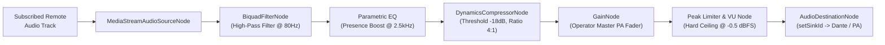

# Technology Stack Architecture

This document provides a comprehensive technical breakdown of the architecture, frameworks, libraries, protocols, and infrastructure powering the **Centralized Mic** ultra-low-latency wireless microphone system.

---

## 1. Executive Architecture Summary

**Centralized Mic** replaces physical handheld RF microphones with attendees' mobile devices (iOS/Android native app or zero-install mobile web transmitter) connected to a centralized host audio receiver over WebRTC. The audio is processed with real-time DSP and piped directly into auditorium/conference room PA systems with a strict **< 300ms end-to-end latency budget**.

```mermaid
flowchart TD
    subgraph Attendees["Transmitter Clients (Edge)"]
        NATIVE_IOS["iOS Native App\n(React Native + AVFoundation)"]
        NATIVE_AND["Android Native App\n(React Native + Foreground Service)"]
        WEB_TRANSMITTER["Browser Web Transmitter\n(mic.html + Web Audio API)"]
    end

    subgraph TokenService["Signaling & Auth Tier"]
        TOKEN_SERVER["Node.js / Express Token Server\n(livekit-server-sdk, Zod, Helmet)"]
    end

    subgraph MediaNetwork["Global WebRTC Media Cloud"]
        LIVEKIT_SFU["LiveKit Cloud SFU\n(Global Anycast Media Router)"]
    end

    subgraph HostReceiver["PA Host Receiver Workstation"]
        HOST_UI["Host Operator Console\n(React 18 + TypeScript + Vite)"]
        WEB_AUDIO_DSP["Web Audio DSP Graph\n(HPF, Parametric EQ, Compressor, Peak Limiter)"]
        FLOOR_ARBITER["Floor Arbiter Engine\n(WebRTC DataChannel Topic: floor-control)"]
        HARDWARE_OUT["Physical PA System\n(Dante / USB Audio Interface / Line Out)"]
    end

    %% Token Flow
    Attendees -->|1. Request JWT Token| TOKEN_SERVER
    HostReceiver -->|1. Request Host JWT Token| TOKEN_SERVER

    %% Media Flow
    Attendees -->|2. Low-Latency Opus Audio (SRTP/UDP)| LIVEKIT_SFU
    LIVEKIT_SFU -->|3. Subscribed Audio Stream| HOST_UI
    HOST_UI --> WEB_AUDIO_DSP --> HARDWARE_OUT

    %% Control Flow
    Attendees <-->|4. PTT & Queue Signals (DataPackets)| LIVEKIT_SFU
    LIVEKIT_SFU <-->|4. Floor Arbiter State Sync| FLOOR_ARBITER
```

---

## 2. Technology Stack Breakdown by Subsystem

### 2.1 Backend Token & Signaling Server (`server/`)

The backend service is a lightweight, stateless microservice responsible for cryptographic token issuance, room access control, rate limiting, and hosting the mobile web transmitter.

| Layer / Concern | Technology | Version | Purpose & Architectural Rationale |
| :--- | :--- | :--- | :--- |
| **Runtime** | Node.js | `>= 20.x` | High-throughput asynchronous event loop for I/O-bound token generation. |
| **Language** | TypeScript | `^5.4.5` | Strong typing across request contracts, error handling, and LiveKit SDK types. |
| **HTTP Framework** | Express.js | `^4.19.2` | Minimalist web framework for REST API endpoints and static asset serving. |
| **LiveKit Server SDK** | `livekit-server-sdk` | `^2.1.2` | Generates signed JSON Web Tokens (JWT) using HMAC-SHA256 containing room permissions, identity grants, and metadata. |
| **Request Validation** | Zod | `^3.23.8` | Strict runtime schema parsing and validation for input room codes, attendee handles, and client metadata. |
| **HTTP Security** | Helmet | `^7.1.0` | Injects protective HTTP security headers (CSP, HSTS, X-Content-Type-Options). |
| **CORS** | `cors` | `^2.8.5` | Configures Cross-Origin Resource Sharing with whitelist validation for host and mobile clients. |
| **Rate Limiting** | `express-rate-limit` | `^7.3.0` | Prevents token generation abuse, brute-force attacks, and denial of service. |
| **Development Tooling** | `ts-node-dev` | `^2.0.0` | Fast TypeScript execution with live code reloading in local development. |

#### Key Server Endpoints:
- `POST /api/token/join`: Issues an attendee token with publishing permissions constrained to a single audio track.
- `POST /api/token/host`: Issues a host token with room administration and floor arbitration privileges.
- `GET /api/health`: Healthcheck probe for Render cloud monitoring.
- `GET /mic`: Serves the zero-install mobile web transmitter (`server/public/mic.html`).

---

### 2.2 Host Receiver & Audio Workstation (`host/`)

The host receiver is an operator-facing web workstation that runs on the computer physically connected to the auditorium or conference room sound system. It acts as the audio processing unit, floor arbiter, and participant dashboard.

| Layer / Concern | Technology | Version | Purpose & Architectural Rationale |
| :--- | :--- | :--- | :--- |
| **Framework** | React | `^18.3.1` | Component-based UI engine managing reactive floor status, queues, and VU meters. |
| **Build Tool & Bundler** | Vite | `^5.2.11` | Ultra-fast Hot Module Replacement (HMR) and optimized Rollup production builds. |
| **Language** | TypeScript | `^5.4.5` | Enforces type safety across audio nodes, LiveKit room events, and floor control protocols. |
| **WebRTC Client** | `livekit-client` | `^2.1.4` | Connects as a subscriber to the LiveKit SFU, handling media stream decapsulation and packet loss recovery. |
| **React Components** | `@livekit/components-react` | `^2.1.2` | LiveKit primitives for reactive state synchronization. |
| **Audio Processing** | Web Audio API | Native Browser | Graph-based audio pipeline running in a dedicated browser audio rendering thread. |
| **Hardware Output Routing** | Web Audio `setSinkId()` | W3C Standard | Direct physical routing to Dante soundcards, USB interfaces, or PA lines. |
| **QR Code Engine** | `qrcode.react` | `^3.1.0` | High-precision SVG QR code rendering with responsive auto-scaling up to 560px for optical scanning. |
| **Styling & Theme** | Tailwind CSS | Utility CSS | Custom dark obsidian palette (`#080a0e`, `#10141c`, `#222834`) with targeted broadcast red accents. |
| **Iconography** | Material Symbols Outlined | Google Fonts | Crisp broadcast hardware icons for audio metering, floor state, and safety cut switches. |

#### Web Audio DSP Pipeline Architecture:


---

### 2.3 Mobile Native Transmitter (`mobile/`)

A dedicated mobile app for iOS and Android optimized for low-latency transmission, acoustic echo suppression, and physical tactile feedback.

| Layer / Concern | Technology | Version | Purpose & Architectural Rationale |
| :--- | :--- | :--- | :--- |
| **Framework** | React Native | `0.74.1` | Native cross-platform mobile runtime. |
| **Core UI Engine** | React | `18.2.0` | UI component tree powering the stage flow screens. |
| **Language** | TypeScript | `^5.4.5` | Type-safe state and native bridge contracts. |
| **WebRTC Engine** | `@livekit/react-native-webrtc` | `144.1.2` | Native C++ WebRTC core ported to iOS and Android. |
| **LiveKit SDK** | `@livekit/react-native` | `^2.12.0` | LiveKit state hooks, room lifecycles, and audio publishing. |
| **Haptic Feedback** | `react-native-haptic-feedback` | `^2.2.0` | Tactile physical click feedback on Push-to-Talk activation and queue updates. |
| **iOS Native Audio** | `AVFoundation` (`AudioSessionConfigModule.mm`) | Objective-C++ | Custom native module setting `AVAudioSessionCategoryPlayAndRecord`, `AVAudioSessionModeVoiceChat`, and selecting bottom microphone hardware input. |
| **Android Foreground** | `MicForegroundService.java` | Java / Android SDK | Android 14 compliant foreground service with `FOREGROUND_SERVICE_TYPE_MICROPHONE` preventing OS audio throttling. |
| **Metro Bundler** | `@react-native/metro-config` | `^0.74.89` | JavaScript packager for React Native. |

---

### 2.4 Attendee Web Transmitter (`server/public/mic.html`)

A zero-install, single-file HTML5/ES6 application designed for attendees who join immediately by scanning the QR code on the auditorium screen without downloading an app.

| Layer / Concern | Technology | Details |
| :--- | :--- | :--- |
| **Architecture** | Single-Page Vanilla HTML5/ES6 | Zero bundler overhead; lightweight payload for cellular networks. |
| **Media Capture** | `navigator.mediaDevices.getUserMedia` | Audio constraints: `echoCancellation: true`, `noiseSuppression: true`, `autoGainControl: true`, `sampleRate: 48000`, `channelCount: 1`, `latency: 0.01`. |
| **LiveKit Client** | `livekit-client` (CDN / UMD) | Direct WebRTC connection to LiveKit SFU. |
| **Visual Level Meter** | HTML5 Canvas API | High-refresh-rate 60fps canvas rendering RMS and peak audio levels. |
| **Touch Ergonomics** | Pointer Events API | Handles `pointerdown`, `pointerup`, `pointercancel`, and `pointerleave` with 44px+ touch targets and iOS safe area padding. |

---

## 3. Real-Time Media & Network Transport Layer

| Component | Choice | Architectural Justification |
| :--- | :--- | :--- |
| **Selective Forwarding Unit (SFU)** | LiveKit Cloud Global Anycast | Distributes WebRTC packet routing across global edge clusters. Ensures single-digit millisecond network hops between attendee phones and the host receiver. |
| **Transport Protocol** | WebRTC over UDP (SRTP / DTLS) | UDP avoids TCP head-of-line blocking, essential for real-time live voice. Automatic fallback to TURN/TLS over port 443 when restricted corporate firewalls block UDP. |
| **Audio Codec** | Opus | 48kHz sampling rate, 20ms frame sizes, full-band voice encoding, dynamic bitrates (64 kbps, 96 kbps, 128 kbps), and in-band Forward Error Correction (FEC). |
| **Floor Control Signaling** | WebRTC DataChannels | Bidirectional low-latency data packets (`topic: 'floor-control'`, `reliable: true`) for instant queue updates without polling HTTP servers. |

---

## 4. End-to-End Latency Budget

To avoid cognitive feedback and echo in a live room, end-to-end latency must remain below **300ms** (ideally < 150ms):

| Pipeline Stage | Latency Contribution | Optimization Applied |
| :--- | :--- | :--- |
| **Microphone Capture & OS Buffer** | `15 - 25 ms` | Low-latency audio modes (`VoiceChat` on iOS, `FLAG_LOW_LATENCY` on Android). |
| **Opus Encoder Packetization** | `20 ms` | 20ms fixed frame duration. |
| **Uplink Network Transit (Phone $\to$ SFU)** | `15 - 40 ms` | Direct UDP transmission over local Wi-Fi / 5G. |
| **SFU Switching & Forwarding** | `< 5 ms` | LiveKit C++ selective forwarding core. |
| **Downlink Transit (SFU $\to$ Host)** | `10 - 30 ms` | Wired gigabit Ethernet recommended for host workstation. |
| **Jitter Buffer (Host Receiver)** | `20 - 40 ms` | Adaptive WebRTC jitter buffer tuned for real-time interactive voice. |
| **Web Audio DSP & Peak Limiter** | `< 5 ms` | Hardware-accelerated browser Web Audio thread. |
| **DAC & PA Speaker Output** | `10 - 20 ms` | Professional ASIO / CoreAudio / Dante hardware buffers. |
| **Total Cumulative Latency** | **`95 - 180 ms`** | **Well within the 300ms budget.** |

---

## 5. Security & Safety Mechanisms

1. **Short-Lived Cryptographic Tokens**: JWT tokens expire within 1 hour (`TOKEN_TTL: 3600`), signed with HMAC-SHA256 secrets stored only on the backend server.
2. **Room Isolation**: Randomly generated room IDs (e.g., `STG-709`, `BOARD-4012`) isolate attendee audio feeds into private SFU channels.
3. **Safety Interlock Cut**: Dual-action hardware-style mute button on the host workstation. Unlocking requires a 2-second armed state to prevent accidental activation.
4. **Hard Volume Limiter**: Peak limiting clamp at `-0.5 dBFS` in the Web Audio graph to prevent speaker blowouts or ear damage from loud feedback.

---

## 6. Hosting & Cloud Infrastructure

The application is deployed across cloud infrastructure declared in `render.yaml`:

```yaml
services:
  # 1. Token Service & Web Transmitter (Node.js/Express)
  - type: web
    name: centralized-mic-token-server
    runtime: node
    rootDir: server
    buildCommand: npm install && npm run build
    startCommand: npm start
    healthCheckPath: /api/health

  # 2. Host Receiver Application (React / Web Audio)
  - type: static
    name: centralized-mic-receiver
    rootDir: host
    buildCommand: npm install && npm run build
    staticPublishPath: dist
```

- **Token Server Host**: Render Web Service (`https://centralized-mic-token-server.onrender.com`).
- **Host Receiver Host**: Render Static Site (distributable globally via edge CDN).
- **SFU Cloud**: LiveKit Cloud Global Network (`wss://*.livekit.cloud`).
